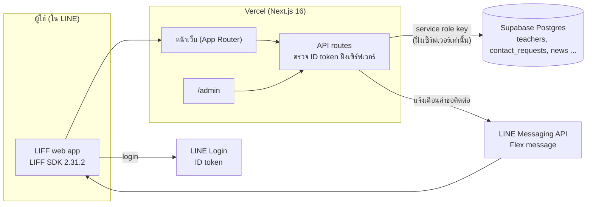
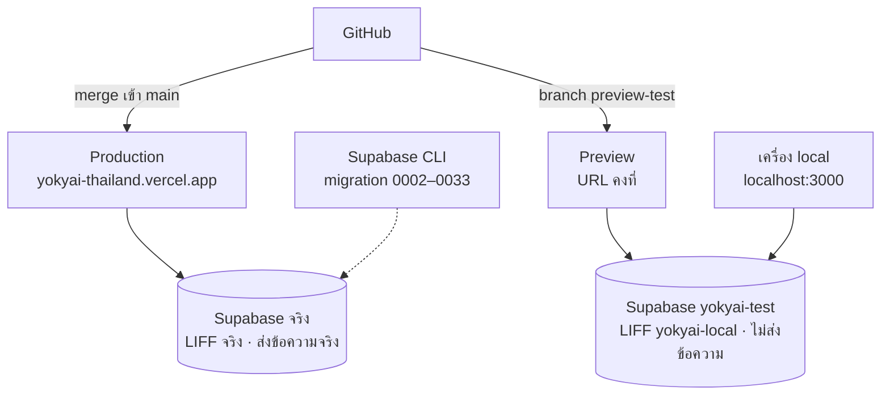

# โครงสร้าง infrastructure ของ yokyai

อัปเดตล่าสุด: 26 ตุลาคม 2026

แอปจับคู่ครูแลกย้ายตำแหน่ง ทำงานเป็นเว็บแอปใน LINE (LIFF) ผู้ใช้ login ด้วยบัญชี LINE

## แผนภาพ

## ส่วนประกอบหลัก

| ชั้น | เทคโนโลยี | หน้าที่ |
|---|---|---|
| Frontend + Backend | Next.js 16 (App Router), Tailwind v4 | หน้าเว็บและ API route ในโปรเจกต์เดียว |
| Hosting | Vercel | deploy อัตโนมัติจาก GitHub |
| ฐานข้อมูล | Supabase (Postgres) | เก็บครู ผลจับคู่ คำขอติดต่อ ข่าว |
| ยืนยันตัวตน | LINE Login + LIFF SDK 2.31.2 | ฝั่งเซิร์ฟเวอร์ตรวจ ID token ของ LINE |
| แจ้งเตือน | LINE Messaging API (Flex message) | ส่งแจ้งเตือนคำขอติดต่อ |
| แอดมิน | `/admin` ล็อกอินด้วยตาราง `admin_users` | จัดการข่าว ผู้ใช้ รอบจับคู่ ข้อมูลหลัก |
| Editor ข่าว | Tiptap + `sanitize-html` | เขียนเนื้อข่าวแบบ HTML และกรองฝั่งเซิร์ฟเวอร์ทั้งตอนบันทึกและตอนอ่าน |

## สภาพแวดล้อม 3 ชุด

| | Production | Preview | เครื่อง local |
|---|---|---|---|
| ที่รัน | `yokyai-thailand.vercel.app` (branch `main`) | URL คงที่ของ branch `preview-test` | `https://localhost:3000` |
| Supabase | โปรเจกต์จริง | `yokyai-test` (ครูปลอม 10 คน) | `yokyai-test` |
| LIFF | app จริง | `yokyai-local` | `yokyai-local` |
| ส่งข้อความ LINE | ส่งจริง | ปิด (ไม่ตั้ง token) | ปิด |
| ปุ่มโหมดทดสอบ | ปิด | เปิด (`NEXT_PUBLIC_DEV_TOOLS`) | เปิด |

ทดสอบได้โดยไม่แตะข้อมูลจริง และ Preview ไม่มีตัวแปรของ prod ปนอยู่

## Flow การ deploy และ database

1. เขียนโค้ดบน branch → เปิด PR → merge เข้า `main` → Vercel deploy production อัตโนมัติ
2. Schema ของ DB จัดการด้วย migration ไฟล์ SQL (0002–0033) ผ่าน Supabase CLI ตอนนี้ลิงก์กับ DB จริง และตรวจรายไฟล์ด้วย `scripts/verify-migrations.sql` ครบแล้ว (รายละเอียดใน [supabase-cli.md](supabase-cli.md))
3. กติกา: รัน migration ก่อน merge โค้ดที่ใช้โครงสร้างใหม่ เพราะเคยพลาด 2 ครั้ง (รายการโปรด, ข่าว)

## โครงสร้างโค้ดที่ออกแบบให้ขยายได้

- **Role registry** (`lib/roles/*`): กติกาตรวจข้อมูล จับคู่ และนับคู่ แยกเป็นโมดูลต่อ role ตอนนี้มี "ครู" ใช้งานจริง และ role ตัวอย่าง `demo` สำหรับพิสูจน์โครงสร้าง เพิ่ม role ใหม่ = เขียนโมดูลเดียว
- ตาราง `teachers` เป็นแกนกลาง ฟิลด์เฉพาะ role ใหม่แยกเป็นตารางส่วนขยายต่อ role

## ความปลอดภัย

- Request ต้องผ่านการตรวจ LINE ID token ฝั่งเซิร์ฟเวอร์ ข้อมูลติดต่อซ่อนจนอีกฝ่ายตอบรับคำขอ
- Service role key อยู่ฝั่งเซิร์ฟเวอร์เท่านั้น แอปไม่ใช้ anon key เลย
- ทุกตารางเปิด Row Level Security และไม่มี policy (default-deny) บวก migration 0037 ที่เพิกถอนสิทธิ์ตารางของ role `anon`/`authenticated` มี test (`lib/rls.test.ts`) กันตารางใหม่ลืมเปิด RLS และ `scripts/verify-migrations.sql` แถว `RLS` ใช้ตรวจ DB จริง
- ข้อสังเกตที่ยังไม่แก้: admin token ส่งใน URL (`?token=`) อาจติดใน log หรือประวัติเบราว์เซอร์ ควรย้ายไป header
- ตัวแปรสภาพแวดล้อมแยก Production กับ Preview

## ความเสี่ยงและงานค้าง

- **ทดสอบอัตโนมัติ:** มี unit test ราว 116 ข้อ แต่ยังไม่มี e2e test
- **Migration ยังรันมือ:** `db push` อัตโนมัติยังไม่เคยลองจริง ต้องพึ่งวินัยในการรันก่อน merge
- **ต้องทดสอบบนเครื่องจริง:** login prod หลังอัปเดต LIFF (LINE จะจำกัด SDK เก่าราว 24 พฤศจิกายน 2026), Flex card ใน LINE จริง, แถบเมนูล่างเทียบ home indicator
- **Preview เปิดสาธารณะ:** ปิด Vercel Authentication เพื่อให้ LINE login เข้าได้ ปลอดภัยเพราะชี้ DB ทดสอบเท่านั้น
- **LIFF ตัวทดสอบมี endpoint เดียว:** ต้องสลับระหว่าง Preview กับ localhost ทางแก้คือสร้าง LIFF app แยกสำหรับ Preview

## เริ่มทำงาน (สำหรับ dev ใหม่)

### สิทธิ์ที่ต้องขอจากเจ้าของโปรเจกต์

| ที่ไหน | ต้องใช้ทำอะไร |
|---|---|
| GitHub `sans-serif-th/yokyai-thailand` | push branch, เปิด PR |
| Vercel โปรเจกต์ `yokyai-thailand` | ดู deployment, ตั้งตัวแปร Preview |
| Supabase โปรเจกต์ทดสอบ `yokyai-test` | รัน SQL, ดูข้อมูล (ขอสิทธิ์โปรเจกต์จริงเฉพาะเมื่อจำเป็น) |
| LINE Developers (LINE Login channel) | ดู/แก้ LIFF app `yokyai-local` และ Channel ID |
| LINE Official Account | ใช้ทดสอบ Flex message จริง (ต้องมี Messaging API token) |

### ตั้งสภาพแวดล้อมทดสอบของตัวเอง

1. ใช้โปรเจกต์ Supabase ทดสอบที่มีอยู่ หรือสร้างใหม่: เปิด SQL editor วาง `supabase/schema.sql` ทั้งไฟล์แล้ว Run
2. วาง `supabase/seed-dev/test-data.sql` เพื่อได้รอบจับคู่ที่เปิดอยู่และครูปลอม 10 คน (ใช้กับโปรเจกต์ทดสอบเท่านั้น)
3. ผูก Supabase CLI กับโปรเจกต์ทดสอบและ mark migration ตาม [supabase-cli.md](supabase-cli.md)
4. ใส่ URL และ service role key ของโปรเจกต์ทดสอบใน `.env.local`
5. ที่ LINE Developers ตั้ง Endpoint URL ของ LIFF app เป็น `https://localhost:3000` (หรือ URL ของ Preview ถ้าจะทดสอบบน Preview) LIFF app หนึ่งตัวมี endpoint ได้ URL เดียว ถ้าต้องสลับบ่อยให้สร้าง LIFF app แยก
6. รัน `npx next dev --experimental-https` เปิดแอปผ่าน LIFF URL แล้ว login ด้วยบัญชี LINE ของตัวเอง จะเห็นครูปลอมในผลจับคู่

### สร้างแอดมินคนแรก

`/admin` ใช้ตาราง `admin_users` ไม่มี default user รัน `node scripts/hash-admin-password.mjs <username>` ใส่รหัสผ่านที่ prompt แล้วเอา `INSERT` ที่พิมพ์ออกมาไปรันใน Supabase SQL editor (รหัสผ่านไม่ออกจากเครื่องเป็นข้อความธรรมดา)

### Preview บน Vercel

- push ไปที่ branch `preview-test` จะได้ URL คงที่ `https://yokyai-thailand-git-preview-test-sans-serif-ths-projects.vercel.app` ซึ่งใช้ตัวแปรชุด Preview (ชี้ `yokyai-test`)
- Vercel Authentication ของโปรเจกต์ปิดอยู่ เพื่อให้ LINE login เข้า Preview ได้
- ตัวแปรชุด Preview ไม่มี `LINE_MESSAGING_ACCESS_TOKEN` โดยตั้งใจ

## กติกาการทำงานร่วมกัน

- แตก branch จาก `main` เสมอ ไม่ commit ตรงเข้า `main` แล้วเปิด PR; ผู้ดูแลเป็นคนสั่ง merge
- **รัน migration กับ DB จริงก่อน merge** โค้ดที่ใช้โครงสร้างใหม่ (`npx supabase db push --dry-run` ก่อนเสมอ) และแก้ `supabase/schema.sql` ให้ตรงกับ migration
- ก่อน merge ต้องผ่าน `npm test`, `npm run lint` และ `npm run build` (Vercel รัน type check ทั้งโปรเจกต์ รวมไฟล์ใต้ `app/dev-preview-*`)
- เขียน migration ใหม่ทุกครั้งให้เพิ่มแถวตรวจใน `scripts/verify-migrations.sql` ด้วย และหลังรัน migration บน DB จริงให้วาง verify ใน SQL editor ดูว่าแถวใหม่และ `RLS` เป็น `true`
- `node scripts/check-columns.mjs` (ต้องตั้ง `SUPABASE_URL` และ `SUPABASE_SERVICE_ROLE_KEY` ของโปรเจกต์ที่จะตรวจ) ตรวจว่า DB มีทุกตารางและคอลัมน์ที่ `schema.sql` ประกาศ อ่านอย่างเดียว ใช้เมื่อสงสัยว่าโครงสร้างหลุด
- ห้าม `migration repair`, `db reset` หรือ `mark-applied` กับโปรเจกต์จริงโดยไม่ได้ตรวจร่วมกับเจ้าของ
- ห้ามนำข้อมูลครูจริงหรือค่า secret ใส่ใน repo, PR หรือ docs
- `NEXT_PUBLIC_DEV_TOOLS` ห้ามตั้งที่ Production (ผู้ใช้ทุกคนจะเห็นปุ่มโหมดทดสอบและเรียก `/api/matches/dev` ได้)
